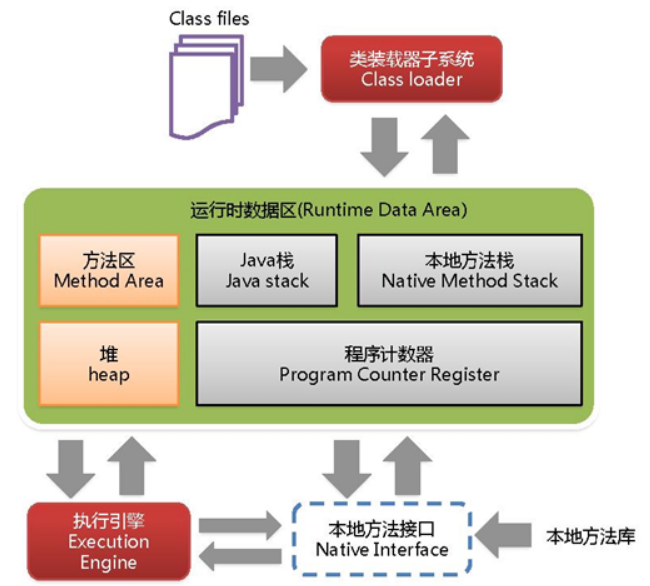

# JVM 概述

## 一、什么是 JVM

JVM（Java Virtual Machine，Java 虚拟机）是一台"虚拟出来的计算机"，它通过软件模拟真实计算机的指令执行过程：读入编译好的字节码文件（`.class`），按照虚拟机规范把它翻译成所在平台（x86、ARM 等）的机器指令并执行。

JVM 有三个层面的含义：

- **一套规范**：《Java 虚拟机规范》定义了字节码指令集、Class 文件格式、运行时数据区、类加载过程、垃圾回收等，只要符合规范，任何实现都可以叫 JVM；
- **一个实现**：如 HotSpot（Oracle/OpenJDK 默认，最主流）、OpenJ9（IBM/Eclipse）、GraalVM、JRockit（已并入 HotSpot）等；
- **一个运行实例**：执行 `java Main` 时启动的那个 JVM 进程，每一次启动都是一个独立的实例。

对应的实现文件在 JDK 安装目录下：`jre/bin/server/jvm.dll`（Windows）或 `jre/lib/server/libjvm.so`（Linux）。

## 二、为什么需要 JVM

### 1、一次编写，到处运行（平台无关）

Java 源码由 `javac` 编译成**与平台无关的字节码**，再由各平台的 JVM 负责"翻译"成机器码。跨平台的能力由 JVM 承担，而不是由 Java 语言本身承担——所谓"Write Once, Run Anywhere"，本质上是"字节码到处一样，JVM 各平台各实现一份"。

### 2、自动内存管理

对象在堆上分配，不再使用时由垃圾回收器（GC）自动回收，开发者基本不需要手动 `free`，避免了大部分内存泄漏与悬空指针问题（代价是可能出现 GC 停顿，需要调优）。

### 3、运行期优化

JVM 可以在运行期间做解释器难以完成的事情：

- 解释执行 + 即时编译（JIT）混合，热点代码编译成本地代码，性能可以接近甚至超过 C/C++（如逃逸分析、方法内联、标量替换）；
- 可以在运行期加载类、反射、动态代理，实现高度的动态性；
- 通过安全管理器、字节码校验等机制提供一定的安全隔离（类加载的双亲委派、`final` 常量校验、栈帧类型校验等）。

## 三、JVM、JRE、JDK 的关系

- **JVM**：执行字节码的虚拟机，是 Java 运行能力的核心；
- **JRE**（Java Runtime Environment）= JVM + 核心类库（`java.lang`、`java.util`、`java.io` 等）+ 支撑文件，只够"运行"程序；
- **JDK**（Java Development Kit）= JRE + 开发工具（`javac`、`javadoc`、`jar`、`jps`、`jstack`、`jmap`、`jconsole` 等），面向开发者。

关系可以简单记为：`JDK ⊃ JRE ⊃ JVM`。

## 四、JVM 的整体结构

JVM 从功能上可分为三大部分：

### 1、类加载子系统（Class Loader Subsystem）

负责根据类的全限定名找到 `.class` 二进制数据，并把它转换成方法区中的运行时数据结构，同时在堆中生成对应的 `java.lang.Class` 对象。过程分为：

1. **加载**：读取字节码，生成 Class 对象；
2. **验证**：文件格式、元数据、字节码、符号引用验证；
3. **准备**：为类变量分配内存并设置零值（`static final` 常量在编译期即赋值）；
4. **解析**：把常量池中的符号引用替换为直接引用；
5. **初始化**：执行 `<clinit>()`，即静态变量赋值与静态代码块。

类加载器采用**双亲委派模型**：Bootstrap → Extension/Platform → Application → 自定义加载器，逐层向上委派，保证核心类不被篡改。

### 2、运行时数据区（Runtime Data Area）

JVM 在运行过程中对内存的划分，是 JVM 学习的主线：

| 区域 | 线程 | 作用 | 主要异常 |
| --- | --- | --- | --- |
| 程序计数器 | 私有 | 当前线程所执行字节码的行号指示器 | 无（唯一不抛 OOM 的区域） |
| 虚拟机栈 | 私有 | 方法调用：栈帧（局部变量表、操作数栈、动态链接、方法出口） | StackOverflowError / OOM |
| 本地方法栈 | 私有 | 为 native 方法服务 | StackOverflowError / OOM |
| 堆 | 共享 | 对象实例、数组，GC 主战场，分新生代/老年代 | OutOfMemoryError: Java heap space |
| 方法区 | 共享 | 类元信息、常量、静态变量、即时编译后的代码缓存 | OutOfMemoryError: Metaspace |

> JDK 1.7 及以前用**永久代**（PermGen）实现方法区，JDK 1.8 起改为**元空间**（Metaspace），使用本地内存。

<div style="text-align: center;">
    
</div>

另外还有一块**直接内存**（Direct Memory），不属于运行时数据区，由 NIO 的 `DirectByteBuffer` 通过本地方法申请，不受 `-Xmx` 限制，受本机物理内存与 `-XX:MaxDirectMemorySize` 约束。

### 3、执行引擎（Execution Engine）

负责"执行字节码"，由三部分组成：

- **解释器**：逐条把字节码翻译成机器码执行，启动快、执行慢；
- **即时编译器（JIT）**：C1（Client，编译快、优化浅）与 C2（Server，编译慢、优化深），通过热点探测（方法调用计数器、回边计数器）挑选热点代码编译，二者分层编译（Tiered Compilation）配合使用；
- **垃圾回收器**：Serial / ParNew / Parallel / CMS / G1 / ZGC / Shenandoah 等，负责回收堆中不再使用的对象。

此外还有**本地方法接口（JNI）与本地方法库**，用于调用 C/C++ 实现的底层功能（如 `System.currentTimeMillis()`、文件 IO、`Unsafe` 等）。

## 五、JVM 的运行流程（从一个 HelloWorld 说起）

```
HelloWorld.java --javac--> HelloWorld.class --类加载--> JVM 运行时数据区 --执行引擎--> 输出结果
```

1. `java HelloWorld` 启动 JVM 进程，找到 `main` 方法所在主类；
2. 类加载子系统加载主类及其依赖类；
3. 主线程创建虚拟机栈，`main` 方法的栈帧入栈；
4. 解释器逐条执行字节码，热点方法交给 JIT 编译；
5. 执行过程中在堆上分配对象，GC 按需回收；
6. `main` 返回、非守护线程全部结束，JVM 退出（也可 `System.exit()` 强制退出）。

## 六、JVM 的生命周期

- **启动**：由引导类加载器创建初始类，执行 `main` 方法。JVM 的启动入口是 `JNI_CreateJavaVM`（由 `java.exe` 通过 `jvm.dll` 调用）。
- **运行**：执行 Java 程序，创建线程、分配内存、执行 GC。
- **退出**：以下情况会退出：
  - 程序正常执行结束；
  - 调用 `System.exit()` 或 `Runtime.exit()`；
  - 遇到未捕获的异常/错误导致主线程终止（其他非守护线程仍在时 JVM 不退出）；
  - 所有非守护线程结束；
  - 操作系统强制终止进程（如 `kill -9`，此时不执行关闭钩子）。

## 七、JVM 的知识体系（本目录文档导航）

| 主题 | 对应文档 |
| --- | --- |
| 内存怎么划分 | [内存结构](内存结构.md) |
| 内存怎么用（分配与回收） | [内存分配与回收策略](内存分配与回收策略.md) |
| 什么算垃圾、怎么回收 | [垃圾回收](垃圾回收.md)、[垃圾回收器](垃圾回收器.md) |
| 类怎么被加载 | [类加载机制](类加载机制.md) |
| 并发下的内存可见性 | [内存模型](内存模型.md) |
| 代码怎么被编译执行 | [Java即时编译](Java即时编译.md) |
| 对象在内存中的样子 | [Java对象头](Java对象头.md) |
| 启动与调优、线上问题 | [JVM的启动过程](JVM的启动过程.md)、[JVM调优](JVM调优.md)、[线上故障排查](线上故障排查.md) |

## 八、常用参数速查

```bash
-Xms512m              # 堆初始大小
-Xmx512m              # 堆最大大小（建议与 -Xms 相同，避免动态扩容）
-Xmn256m              # 新生代大小
-Xss1m                # 每个线程的栈大小
-XX:MetaspaceSize=128m        # 元空间初始阈值
-XX:MaxMetaspaceSize=256m     # 元空间上限
-XX:+UseG1GC                  # 使用 G1 收集器
-XX:+HeapDumpOnOutOfMemoryError -XX:HeapDumpPath=/tmp/dump.hprof   # OOM 时导出堆快照
-Xlog:gc*                     # JDK9+ 打印 GC 日志（JDK8 为 -XX:+PrintGCDetails）
```

常用排查工具：`jps`（查看进程）、`jstat`（GC 统计）、`jmap`（堆快照/直方图）、`jstack`（线程栈）、`jcmd`（综合命令）、`jconsole`/`VisualVM`/`Arthas`（可视化与在线诊断）。
