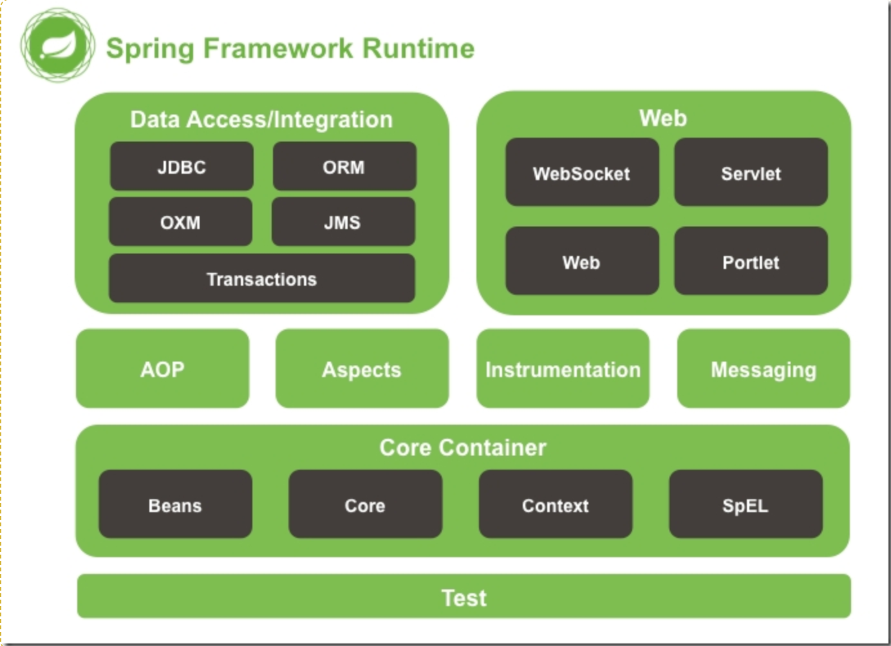

# spring

## 架构图

## 模块

### Core Container

核心容器(Core Container)

- `spring-beans` 该模块是依赖注入IoC与DI的最基本实现
- `spring-core` 该模块是Bean工厂与bean的装配
- `spring-context` 该模块构架于核心模块之上，它扩展了 BeanFactory，为它添加了 Bean 生命周期控制、框架事件体系以及资源加载透明化等功能。ApplicationContext 是该模块的核心接口，它的超类是
  BeanFactory。与BeanFactory 不同，ApplicationContext 容器实例化后会自动对所有的单实例 Bean 进行实例化与依赖关系的装配，使之处于待用状态
- `spring-context-indexer` 该模块是 Spring 的类管理组件和 Classpath 扫描
- `spring-context-support` 该模块是对 Spring IOC 容器的扩展支持，以及 IOC 子容器
- `spring-expression` 该模块是Spring表达式语言块是统一表达式语言（EL）的扩展模块，可以查询、管理运行中的对象，同时也方便的可以调用对象方法、操作数组、集合等

### Data Access/Integration

数据访问/集成

- `spring-jdbc` 该模块提供了 JDBC抽象层，它消除了冗长的 JDBC 编码和对数据库供应商特定错误代码的解析
- `spring-tx` 该模块支持编程式事务和声明式事务，可用于实现了特定接口的类和所有的 POJO 对象。编程式事务需要自己写beginTransaction()、commit()、rollback()
  等事务管理方法，声明式事务是通过注解或配置由 spring 自动处理，编程式事务粒度更细
- `spring-orm` 该模块提供了对流行的对象关系映射 API的集成，包括 JPA、JDO 和 Hibernate 等。通过此模块可以让这些 ORM 框架和 spring 的其它功能整合，比如前面提及的事务管理
- `spring-oxm` 该模块提供了对 OXM 实现的支持，比如JAXB、Castor、XML Beans、JiBX、XStream等
- `spring-jms` 该模块包含生产（produce）和消费（consume）消息的功能。从Spring 4.1开始，集成了 spring-messaging 模块

### Web

网络部分

- `spring-web` 该模块为 Spring 提供了最基础 Web 支持，主要建立于核心容器之上，通过 Servlet 或者 Listeners 来初始化 IOC 容器，也包含一些与 Web 相关的支持
- `spring-webmvc` 该模块众所周知是一个的 Web-Servlet 模块，实现了 Spring MVC（model-view-Controller）的 Web 应用
- `spring-websocket` 该模块主要是与 Web 前端的全双工通讯的协议
- `spring-webflux` 该模块是一个新的非堵塞函数式 Reactive Web 框架，可以用来建立异步的，非阻塞，事件驱动的服务，并且扩展性非常好。

### 面向切面编程(AOP和Aspects)

- `spring-aop` 该模块是Spring的另一个核心模块，是 AOP 主要的实现模块
- `spring-aspects` 该模块提供了对 AspectJ 的集成，主要是为 Spring AOP提供多种 AOP 实现方法，如前置方法后置方法等

### 设备(Instrumentation)

- `spring-instrument` 该模块是基于JAVA SE 中的"java.lang.instrument"进行设计的，应该算是 AOP的一个支援模块，主要作用是在 JVM
  启用时，生成一个代理类，程序员通过代理类在运行时修改类的字节，从而改变一个类的功能，实现 AOP 的功能

### 消息(Messaging)

- `spring-messaging` 是从 Spring4 开始新加入的一个模块，主要职责是为 Spring 框架集成一些基础的报文传送应用

### 测试(Test)

- `spring-test` 主要为测试提供支持的，通过 JUnit 和 TestNG 组件支持单元测试和集成测试。它提供了一致性地加载和缓存 Spring 上下文，也提供了用于单独测试代码的模拟对象（mock object）

## 文档导航

本文件只保留 Spring 的总体概览（架构、模块），具体知识点按主题拆分为以下子文档：

| 子文档 | 内容 |
|:---|:---|
| [Spring-IoC](Spring-IoC.md) | IoC 概念与好处、BeanFactory 与 ApplicationContext 的对比、IoC 初始化过程、`@Autowired` 原理与装配流程、`@Autowired` 与 `@Resource` 的区别、BeanFactory 与 FactoryBean |
| [Spring-Bean](Spring-Bean.md) | Bean 生命周期与扩展点、五种作用域、循环依赖与三级缓存、单例 Bean 的线程安全问题 |
| [Spring-AOP](Spring-AOP.md) | AOP 概念、JDK 与 CGLib 动态代理、AOP 术语、Spring 对 AOP 的支持、自定义注解的完整示例 |
| [Spring-事务](Spring-事务.md) | 编程式与声明式事务、七种传播行为、事务边界怎么划、事务失效的常见场景与排查 |
| [Spring-设计模式](Spring-设计模式.md) | 简单工厂、工厂方法、单例、适配器、装饰器、代理模式在 Spring 中的体现 |

其他相关文档：[SpringMVC](SpringMVC.md)、[SpringBoot](SpringBoot.md)、[springcloud](springcloud.md)、[Spring拦截器与过滤器](Spring拦截器与过滤器.md)、[spring常见面试题](spring常见面试题.md)。

## spring中properties和yml的加载顺序

相同内容properties和yml的加载顺序是properties优先

# 参考文章

- https://www.jianshu.com/p/5e7c0713731f
- https://blog.csdn.net/nuomizhende45/article/details/81158383
- https://www.cnblogs.com/javazhiyin/p/10905294.html
- https://www.jianshu.com/p/1dec08d290c1
- https://blog.csdn.net/icarus_wang/article/details/51586776
- https://cloud.tencent.com/developer/article/1512235
- https://zhuanlan.zhihu.com/p/114244039
- https://blog.csdn.net/qq_41701956/article/details/116354268
- https://blog.csdn.net/weixin_41980692/article/details/105803311
- https://juejin.cn/post/6844903967600836621
- https://juejin.cn/post/6882266649509298189
